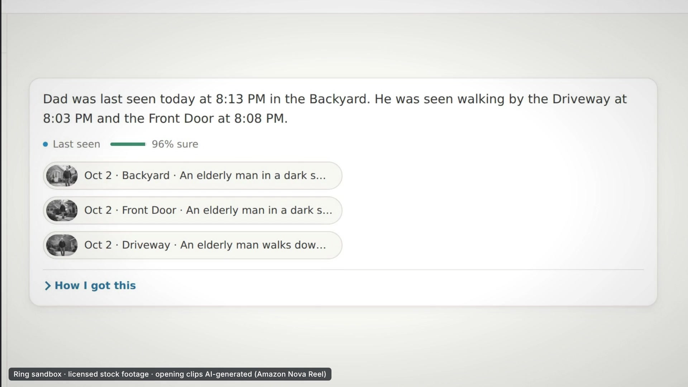
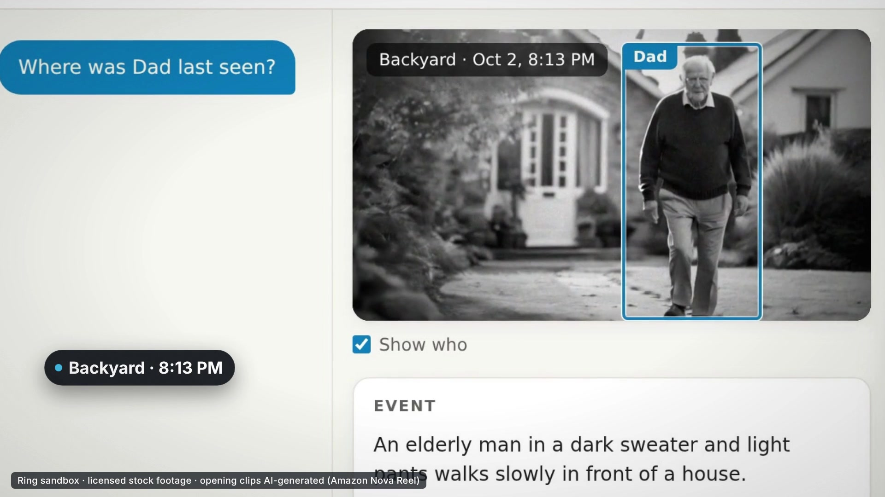
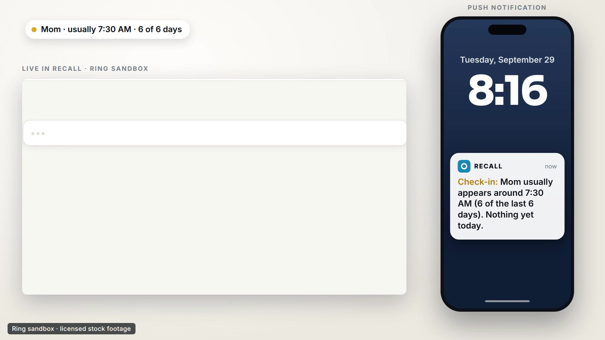
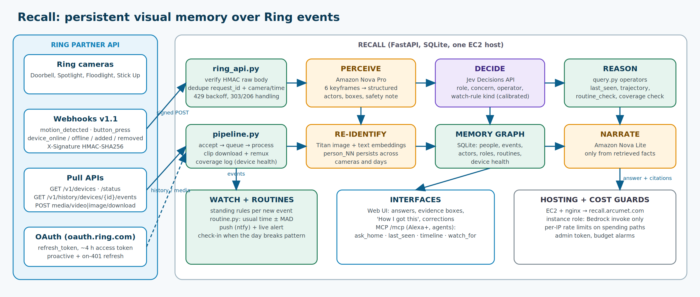
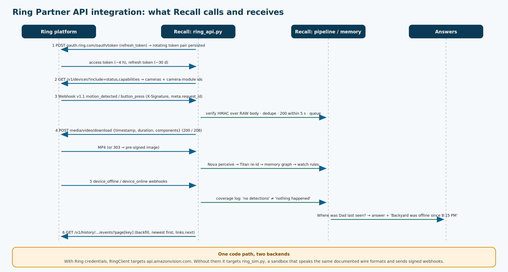

# Recall

> Not security AI. Not video search. Not facial recognition. **Persistent visual memory for caretaking and safety.**

**Amazon Developer Hackathon, Ring track (caretaking) · AWS Builder mini challenge · Open Source mini challenge · Alexa+ MCP server**

It's 8:20 PM. Your father is 81 and lives alone. He isn't answering his phone. The cameras have already seen everything, but a camera shows you a video, and a caregiver needs an answer.

**Recall gives a home a memory.** Ask *"Where was Dad last seen?"* and instead of "3 matching videos" you get one reconstructed answer:

> *Dad was last seen today at 8:13 PM in the Backyard, approaching the door and hugging someone.*
> Driveway 8:03 PM → Front Door 8:08 PM → Backyard 8:13 PM, a box on him in every clip, the exact second to jump to, then **"no later detections."**

And it doesn't wait to be asked. Recall learns each named person's routine and pushes a check-in when the day breaks pattern: *"Mom usually appears around 7:30 AM (6 of the last 6 days). Nothing yet today."*

## Judge quickstart (3 clicks, no setup)

Live demo: **https://recall.arcumet.com** (pre-seeded; nothing to install, nothing to sign in to).

1. **[Ask "Where was Dad last seen?"](https://recall.arcumet.com/?step=1)**: one reconstructed answer with the path across cameras, a tracked box on him in every clip, and "no later detections".
2. **[Ask "Is Mom's day normal today?"](https://recall.arcumet.com/?step=2)**: the routine engine's answer (usual time, how many days, nothing yet today).
3. **[Emit a Ring event](https://recall.arcumet.com/?step=3)**: opens *Demo → Emit Ring event*. The event goes through the signed Ring webhook, is ingested live (clip download → Nova → Titan → memory) and shows up in the timeline.

Bonus for the Ring-minded: in the same drawer, send **device_offline** for the Backyard, then redo step 1. The answer now warns that "no later detections" is not conclusive because Ring reported that camera offline. That is Recall using Ring's device lifecycle webhooks to tell *nothing happened* from *nobody was watching*.

## Screenshots

| Answer with evidence | Tracked on every clip | Proactive check-in |
|---|---|---|
|  |  |  |



- 🎬 **Demo video:** see the Devpost submission · 📝 **Submission text:** [`SUBMISSION.md`](SUBMISSION.md) · 🧾 **Product feedback:** [`PRODUCT_FEEDBACK.md`](PRODUCT_FEEDBACK.md) · 🪵 **Friction log:** [`FRICTION_LOG.md`](FRICTION_LOG.md)

```
Ring API / webhook ─► PERCEIVE ─► DECIDE ─► RE-IDENTIFY ─► MEMORY ─► REASON ─► answer + evidence
  (signed, HMAC)      Nova Pro     Jev       Titan          SQLite    operators   Nova Lite narrates
                      keyframes →  role +    person_NN      graph     + Jev       only from facts
                      structured   concern   across cameras                              │
                      event record per actor and days                    WATCH ◄──────────┘
                                                              routines + "tell me next time…" → push + live alert
```

## What is real

| Layer | Implementation |
|---|---|
| **Ring** | `ring_api.py` is a client written against the Ring Partner API docs (`api.amazonvision.com`, JSON:API). **OAuth:** `refresh_token` grant against `oauth.ring.com`, refreshed proactively from `expires_in` and on 401, rotated pair persisted. **Discovery:** `GET /v1/devices?include=status,capabilities` (camera-module ids for multi-camera devices such as Ring Elite). **History:** `history-events` (epoch-ms `start`/`end`), `event_types` filter, `links.next` cursor pagination. **Media:** `POST media/video/download` with `{timestamp, duration, components:[{component_id}]}` (200 full / 206 partial, redirects followed) and `media/image/download` (303 → pre-signed URL, bearer not forwarded). **Rate limits:** 429 + `Retry-After` exponential backoff. **Webhooks v1.1:** `POST /ring/webhook` verifies `X-Signature` (HMAC-SHA256 over the raw body), de-duplicates on `meta.request_id` *and* on camera + time (a webhook id and a history id differ for the same event), acknowledges immediately and processes asynchronously; `motion_detected`, `button_press` and the lifecycle events `device_online/offline/added/removed`. |
| **Ring, used in an original way** | **Coverage-aware memory.** Lifecycle webhooks feed a per-camera downtime log (`device_health`). A "last seen" answer checks whether any camera was offline after the last sighting; if so it drops the "no later detections" claim, lowers confidence and says which camera was dark and since when. Absence of evidence is only evidence if someone was watching. |
| **Perception (AWS)** | Amazon Nova Pro (Bedrock Converse, multi-image): 6 keyframes → one structured record, actors tracked across frames, appearance, carried objects, actions, interactions, a body box per keyframe, and a hedged safety observation. It observes only; it never names people or decides roles. |
| **Decisions** | Every classification is a typed, calibrated choice from TypeSafe's Jev model through the Decisions API, each actor's role and concern, the question's reasoning operator, the subject, the watch-rule kind (~130 ms per call). Generative models only observe and narrate. |
| **Re-identification (AWS)** | Titan image embedding of the body crop + Titan text embedding of appearance + attribute overlap → a blended score against stored exemplars. `person_NN` nodes persist across events, days and cameras. Appearance-based; **no face recognition, no face templates.** |
| **Roles across events** | A person's role is the evidence-weighted posterior over all their events, shrunk toward "unknown". The "89%" on screen is that stored number, not a language model's opinion. |
| **Reasoning** | `query.py` operators: `identify_person`, `find_events`, `last_seen`, `trajectory`, `after_departure`, `security_incident`, `routine_check`, `describe_person`, `count`, `watch_request`. Dates are resolved by `timeparse.py`, never by a model. Every answer carries citations, a timeline and human-readable reasoning steps. |
| **Evidence you can see** | The UI interpolates the per-keyframe boxes over the clip, so a citation shows *who* it is about, not just a timestamp. |
| **Routine + proactive check-ins** | `routine.py` learns each person's usual time of day (median ± MAD; needs 3+ days and 60% regularity). A background loop (`routine.notify_overdue`) pushes one check-in per person per day when a named person is overdue or turns up at a very unusual hour. |
| **Corrections** | "That's not him": move a sighting, split a person, or merge two. Every sighting stores its own embedding, so identities are rebuilt from the sightings that remain and future matching improves. |
| **Watch** | Standing rules from conversation (`person_arrives`, `person_departs_window`, `role_arrives`, `unknown_at_night`) are evaluated on every new event → push notification + live alert. |
| **Alexa+ / agents** | `POST /mcp`, Streamable HTTP, JSON-RPC 2.0, protocol `2025-11-25`, Origin validation, optional bearer token. Tools: `ask_home`, `last_seen`, `get_timeline`, `list_people`, `watch_for`. |

## Try it

You need an AWS account with Amazon Bedrock access (Nova Pro, Nova Lite, Titan) and an OpenRouter key (for the Jev Decisions API).

```bash
pip install -r requirements.txt
cp .env.example .env                                   # add OPENROUTER_API_KEY; AWS credentials via the standard AWS chain
python3 -m uvicorn server:app --host 127.0.0.1 --port 8000     # UI at http://localhost:8000
python3 seed.py                                        # back-fill a multi-day history through the Ring sandbox + full pipeline (~2–3 min)
python3 -m pytest tests -q                             # 44 offline tests (Jev / Nova / network stubbed)
```

**A 3-minute tour of the UI** (after `seed.py`):
1. Click **Where was Dad last seen?**, read the answer, click a citation chip, watch the box track him; open **How I got this**.
2. Click **Is Mom's day normal today?**, the routine engine's answer; the *Needs attention* card shows the same check-in.
3. Open **Demo → Emit Ring event**, a Ring event goes through the **signed webhook**, is ingested live, and appears in the timeline.
4. Ask **Tell me next time this person comes**, then emit that person's event again, the rule fires.
5. On any event, click **Not them?** to correct an identity; open **How it works** for the architecture and live engine names.
6. MCP: `curl -X POST $URL/mcp -H 'content-type: application/json' -d '{"jsonrpc":"2.0","id":1,"method":"tools/call","params":{"name":"ask_home","arguments":{"question":"Where was Dad last seen?"}}}'`

`rehearse.py` runs perception and role decisions on each staged clip **without** touching the memory and checks the `expect` block in `demo_clips/manifest.json` (actions, carried objects, role, flags), so you know a shot will support its demo question. `seed.py` reads `demo_clips/manifest.json` (see `demo_clips/README.md` for the shot list).

### Going live with real Ring
Set `RING_CLIENT_ID`, `RING_CLIENT_SECRET`, `RING_REFRESH_TOKEN` (or a short-lived `RING_ACCESS_TOKEN`) and `RING_HMAC_KEY` (the signing key Ring issued for your app), register `https://<host>/ring/webhook` as the Webhook URL in the Ring Developer Portal, then `POST /api/ring/sync` to back-fill history. No code changes: `ring_api.mode()` flips from `sandbox` to `live`. This needs Ring Partner credentials and at least one Ring device.

### What is real and what is simulated (read this first)
- **Real code, real wire formats:** the client, OAuth refresh, signature verification, dedupe, pagination, media handling and lifecycle handling are written to the published Ring Partner API spec and unit-tested against mocked transports (`tests/test_recall.py`).
- **Simulated source:** the Ring *cloud* is `ring_sim.py`, because we had no Partner credentials or hardware. It serves the same documented endpoints and sends correctly signed Webhook v1.1 payloads, so every byte of the ingest path is the production path. The footage is staged stock/AI clips, and the demo history is seeded through that sandbox. Nothing here has been run against `api.amazonvision.com`.
- **Real AWS:** every Nova/Titan call in the live demo is a real Bedrock call.



### Deploying to your own EC2 host
`deploy/` contains a small, idempotent deployment for an existing Ubuntu EC2 instance: a Bedrock-invoke-only IAM role for the instance (no keys copied), a systemd service on port 8300, an HTTPS tunnel, and a seed run. Copy `deploy/host.env.example` to `deploy/host.env`, fill it in, and run `bash deploy/go.sh`.

## Public-deployment safeguards
Per-client rate limits on the endpoints that spend money (`/api/ask`, `/api/demo/emit`, `/mcp`); an `ADMIN_TOKEN` guarding the destructive endpoints (`/api/demo/seed`, `/api/demo/checkin`); HMAC-verified, idempotent webhooks; MCP Origin validation and optional bearer token.

## Honest limitations
- Re-identification is appearance-based (clothing, build, colour). Someone who changes clothes becomes a new person until named; two people dressed alike can merge. `REID_MATCH` was calibrated on a small clip set, see `FRICTION_LOG.md`.
- **Security flags are unverified observations**, phrased as such ("appears to raise an object consistent with a handgun"); the clip is the ground truth. Recall is a memory and retrieval system, not a weapon detector.
- Everything was exercised against the Ring **sandbox** with licensed stock footage; the demo history is seeded (only the ingest path is real). Payload parsing follows the published docs; fields the docs mark optional are read defensively.
- Frames are processed by Amazon Bedrock; memory (SQLite, clips, thumbnails) stays in `data/` on the host.

## Layout
`server.py` API + UI + webhook + MCP · `ring_api.py` client / OAuth / HMAC · `ring_sim.py` sandbox (docs/architecture/ has the diagrams) · `pipeline.py` ingest · `perceive.py` Nova · `identity.py` re-id and corrections · `roles.py` role posterior · `query.py` operators · `routine.py` routines and check-ins · `digest.py` Today card · `watch.py` rules · `timeparse.py` · `aws.py` Bedrock · `jev.py` Decisions API + question sets · `db.py` / `views.py` · `static/index.html` UI · `seed.py` · `rehearse.py` · `deploy/` · `tests/` · `video/` (demo-video source: HyperFrames scenes, ElevenLabs audio scripts, screen-capture harness, see `video/README.md`). `docs/v1/` holds the earlier HomeGuard prototype's docs, which Recall grew from.

Sample footage in `demo_clips/` stands in for a real household: stock video from [Mixkit](https://mixkit.co/license/#videoFree) (Mixkit Free License), plus AI-generated clips of an older man (Dad) made with Amazon Nova Reel (`video/generate_reel.py`, labelled in the video).

MIT licensed. Built during the submission period (Aug 31 – Oct 23, 2026).
